# PR0201: Despliegue de sitio web estático en AWS S3
1. Objetivos
* Comprender el modelo de almacenamiento plano basado en claves/prefijos frente a la jerarquía de directorios tradicional.
* Gestionar el ciclo de seguridad por capas en S3: el interruptor de bloqueo global (Block Public Access) y las políticas basadas en recursos (Bucket Policies).
* Escribir, validar y depurar políticas de acceso en formato JSON estándar.
* Habilitar y comprobar el funcionamiento del motor de alojamiento web estático de S3 frente al acceso directo a objetos vía API/REST.
2. Requisitos previos y restricciones en AWS Academy
* Disponer de acceso al aula de AWS Academy Learner Lab con el laboratorio iniciado.
* Recordar que las credenciales de consola caducan tras finalizar la sesión de laboratorio, aunque la infraestructura desplegada (buckets y objetos) se mantiene persistente mientras no se reinicie el lab.
* Nomenclatura global: Dado que los nombres de los buckets de S3 deben ser globalmente únicos a nivel mundial, cada alumno debe emplear obligatoriamente la convención: web-asir-[iniciales]-[año] (ejemplo: web-asir-vjgr-2026).

---

3. Preparación del entorno local
Crea en tu máquina local una carpeta de trabajo llamada s3-website/ con los siguientes archivos mínimos: ```index.html ```

```

<!DOCTYPE html>
<html lang="es">
<head>
    <meta charset="UTF-8">
    <title>Servicio Web Estático - ASIR Cloud</title>
    <link rel="stylesheet" href="css/estilos.css">
</head>
<body>
    <header>
        <h1>Infraestructura Web sobre Amazon S3</h1>
        <p>Alojamiento sin servidor (Serverless Object Storage)</p>
    </header>
    <main>
        <section>
            <h2>Información del Nodo</h2>
            <p>Este sitio se sirve directamente mediante Amazon S3 Website Endpoint sin intermediación de servidores Apache o Nginx.</p>
        </section>
    </main>
</body>
</html> 

```
```error.html```

```

<!DOCTYPE html>
<html lang="es">
<head>
    <meta charset="UTF-8">
    <title>404 - Recurso No Encontrado</title>
</head>
<body>
    <h1>Error 404</h1>
    <p>El objeto o clave solicitado no existe en este bucket de S3.</p>
</body>
</html>

```

```css/estilos.css```

```

body {
    font-family: Arial, sans-serif;
    margin: 40px;
    background-color: #f4f6f8;
    color: #333;
}
header {
    border-bottom: 2px solid #232f3e;
    padding-bottom: 10px;
}


```

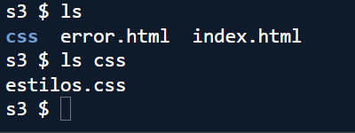

<b><hr></b>

## 4. Desarrollo de la práctica

###  Fase 1: Creación del Bucket S3
1. Inicia sesión en la consola de AWS a través del Learner Lab.
2. Accede al servicio S3 y haz clic en Crear bucket.
3. Configura los parámetros:

    * Tipo de bucket: Propósito general (General purpose). 
 
    * Nombre del bucket: web-asir-[tunombre]-[año]. 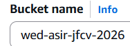

    * Región: us-east-1 (Norte de Virginia).
    * Propiedad de objetos: ACL deshabilitadas (recomendado).
    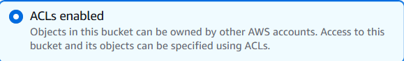

    * Bloquear todo el acceso público: Deja marcada la casilla de bloqueo total por ahora.

4. Finaliza haciendo clic en Crear bucket. 

### Fase 2: Subida y snálisis de objetos
1. Entra en el bucket recién creado y utiliza el botón Cargar para subir:

* Los archivos index.html y error.html en la raíz del bucket. 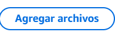
* La carpeta css/ con el archivo estilos.css en su interior. 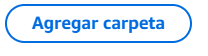


2. Observa la clave del archivo CSS: css/estilos.css. S3 simula carpetas mediante prefijos, pero la clave del objeto contiene la ruta completa.
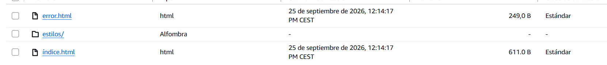

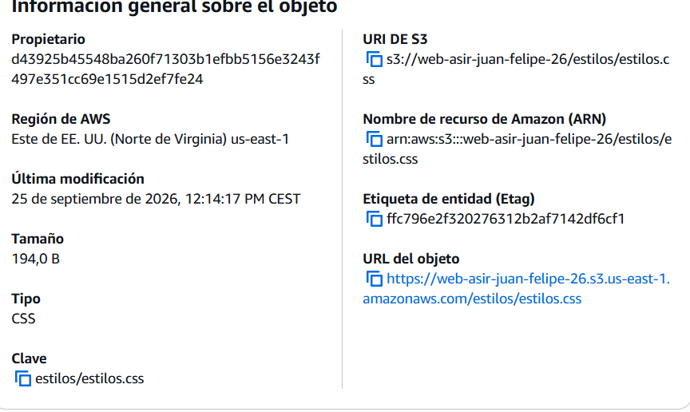

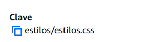

3. Haz clic sobre index.html y pulsa el botón Abrir de la consola

    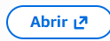

    * Pregunta: ¿Por qué puedes ver el archivo sin errores en este punto? Observa la URL con tokens en la barra de direcciones.

### Fase 3: Habilitación de “Static Website Hosting”
1. Dentro de la vista del bucket, ve a la pestaña Propiedades.
2. Desplázate hasta el final hasta la sección Alojamiento de sitios web estáticos (Static website hosting) y pulsa Editar.
3. Selecciona:

    * Alojamiento de sitios web estáticos: Habilitar. 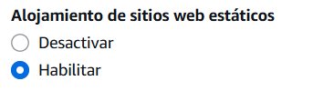
    * Tipo de alojamiento: Alojar un sitio web estático. 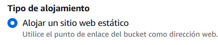
    * Documento de índice: index.html.
    * Documento de error: error.html.
    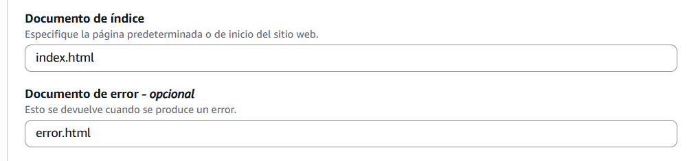

4. Guarda los cambios. Al guardar, se genera el Endpoint del sitio web (formato: http://[bucket-name].s3-website-us-east-1.amazonaws.com). 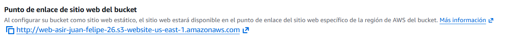

5. Intenta acceder a dicho endpoint desde el navegador. Obtendrás un error HTTP 403 Forbidden porque el acceso público sigue completamente bloqueado a nivel de bucket.

### Fase 4: Desbloqueo y Política de Acceso JSON
Para que el endpoint web pueda servir las páginas, es necesario configurar tanto el interruptor general como la política de acceso de lectura.
1. Ve a la pestaña Permisos del bucket.
2. En la sección Bloquear acceso público (configuración del bucket), pulsa Editar.
3. Desmarca la casilla Bloquear todo el acceso público y guarda los cambios (deberás escribir confirmar en el cuadro de diálogo de AWS).
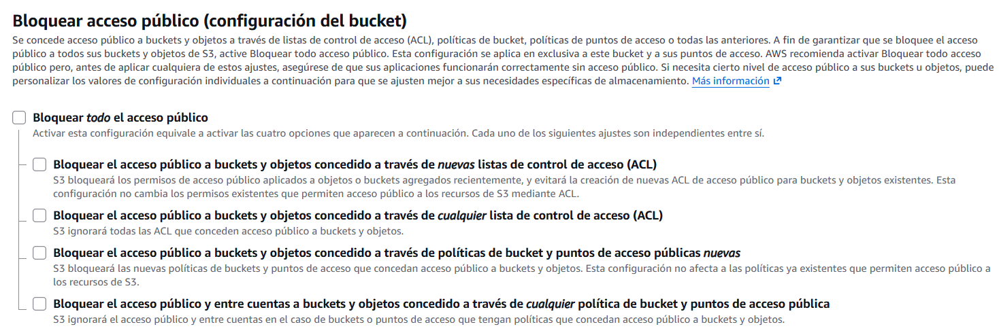
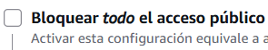
4. En esa misma pestaña, busca el apartado Política de bucket y pulsa Editar.

5. Redacta la siguiente directiva JSON, sustituyendo el valor de Resource por el ARN de tu bucket:
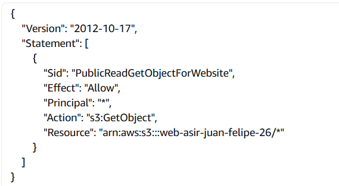
```

{
    "Version": "2012-10-17",
    "Statement": [
      {
        "Sid": "PublicReadGetObjectForWebsite",
        "Effect": "Allow",
        "Principal": "*",
        "Action": [
          "s3:GetObject"
        ],
        "Resource": "arn:aws:s3:::web-asir-juan-felipe-26/*"
      }
    ]
  }

```

1. Guarda la política. Accede nuevamente al endpoint del sitio web estático generado en la Fase 3 y comprueba que la página carga con sus estilos CSS aplicados.
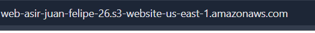
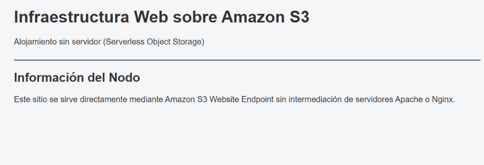

2. Fuerza un error accediendo a una ruta inexistente http://[bucket-name][.s3-website-us-east-1.amazonaws.com/test-error](https://.s3-website-us-east-1.amazonaws.com/test-error) y comprueba que se muestra el archivo error.html.
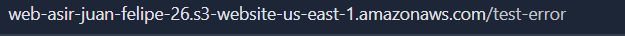

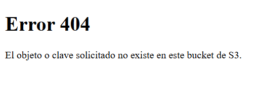
### Fase 5: restricción de acceso por red (Dirección IP)
En entornos corporativos reales, los sitios de pruebas y documentación interna no deben ser públicos para todo Internet, sino limitarse a la red del centro educativo o empresa.

1. Averigua tu dirección IP pública actual.
2. Modifica la política de bucket introduciendo una condición IpAddress vinculada a aws:SourceIp:

```

  {
    "Version": "2012-10-17",
    "Statement": [
      {
        "Sid": "AllowAccessOnlyFromCampusIP",
        "Effect": "Allow",
        "Principal": "*",
        "Action": "s3:GetObject",
        "Resource": "arn:aws:s3:::[NOMBRE-EXACTO-DE-TU-BUCKET]/*",
        "Condition": {
          "IpAddress": {
            "aws:SourceIp": "[TU_IP_PUBLICA]/32"
          }
        }
      }
    ]
  }

```
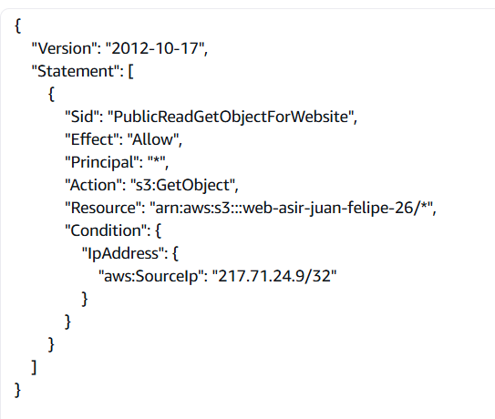

1. Comprueba el acceso desde el navegador de tu equipo (debe funcionar).

2. Desconecta tu smartphone de la red Wi-Fi (usando datos móviles) o prueba desde otra red para intentar abrir el mismo enlace.

3. Confirma que la solicitud es rechazada con un error 403 Forbidden.
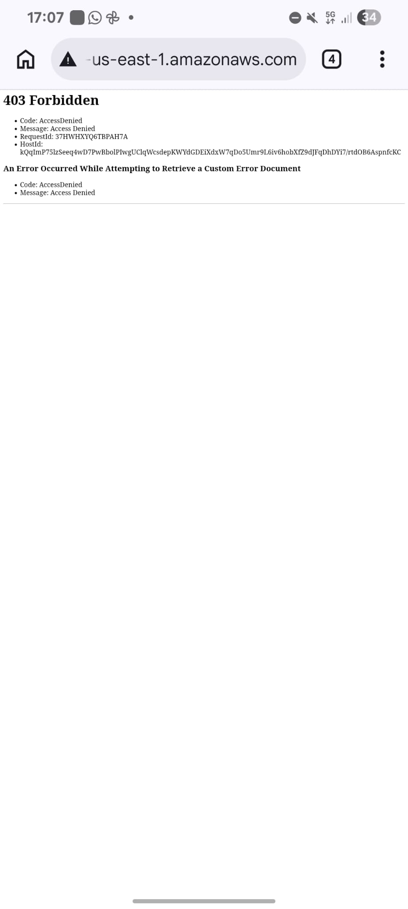