# PR0203: Protección contra desastres y optimización de almacenamiento

## Fase 1: Creación del repositorio y activación de versionado

1. Creación del bucket: crea el bucket manteniendo activado el bloqueo total de acceso público.

```

 aws s3 mb s3://asir-alumno-2026-storage


```

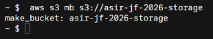

2. Activación de versionado: habilita el versionado en el bucket mediante la CLI o la pestaña Propiedades de la consola:

```

 aws s3api put-bucket-versioning \
 --bucket asir-alumno-2026-storage \
 --versioning-configuration Status=Enabled

```
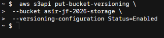

3. Verificación: comprueba el estado del versionado:

```

 aws s3api get-bucket-versioning --bucket asir-alumno-2026-storage

```
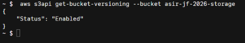

## Fase 2: Simulación de sobreescritura y recuperación de versiones
1. <b>Generación y carga de la primera versión:</b> crea un fichero local contrato_sla.txt con el texto "Versión 1.0 - SLA 99.0%" y súbelo a S3:

```
 echo "Versión 1.0 - SLA 99.0%" > contrato_sla.txt
 aws s3 cp contrato_sla.txt s3://asir-alumno-2026-storage/contratos/contrato_sla.txt

```

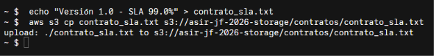

2. <b>Sobreescritura accidental:</b> modifica el fichero local simulando un error ("Versión 2.0 - SLA 90.0% CORRUPTO") y vuelve a subirlo con el mismo nombre y ruta en el bucket.
 
 ```

 echo "Versión 2.0 - SLA 90.0% CORRUPTO" > contrato_sla.txt
 aws s3 cp contrato_sla.txt s3://asir-alumno-2026-storage/contratos/contrato_sla.txt

 ```

 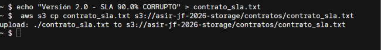

3. <b>Inspección de versiones:</b> lista los identificadores únicos (VersionId) asociados al objeto:
 
 ```

 aws s3api list-object-versions \
 --bucket asir-alumno-2026-storage \
 --prefix contratos/contrato_sla.txt \
 --query "Versions[].{VersionId:VersionId, Modificado:LastModified, EsActual:IsLatest}" \
 --output table

```

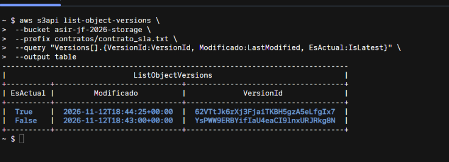

4. <b>Recuperación de la versión original:</b> descarga explícitamente la VersionId correspondiente a la versión 1.0 para verificar que la información original sigue intacta.
 
 ```
 
 aws s3api get-object \
 --bucket asir-alumno-2026-storage \
 --key contratos/contrato_sla.txt \
 --version-id "PEGAR_AQUI_EL_VERSION_ID_V1" \
 contrato_recuperado.txt
 cat contrato_recuperado.txt

```
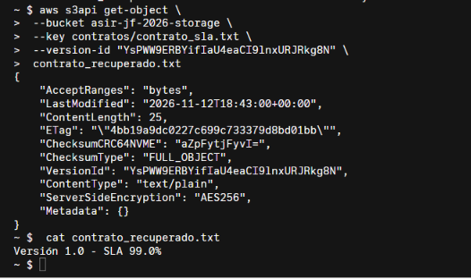

## Fase 3: Simulación de borrado y análisis de marcas de borrado

1. Borrado simple del objeto: ejecuta un comando de borrado estándar. Después comprueba el contenido del bucket con aws s3 ls s3://asir-alumno-2026-storage/contratos/. El fichero aparentemente ha desaparecido.:

```
 aws s3 rm s3://asir-alumno-2026-storage/contratos/contrato_sla.txt

```
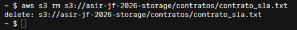

2. <b>Auditoría forense con</b> ``` list-object-versions: ``` ejecuta el listado exhaustivo para localizar los <b>Delete Markers:</b>
 
 ```
 
 aws s3api list-object-versions \
 --bucket asir-alumno-2026-storage \
 --prefix contratos/contrato_sla.txt \
 --query "DeleteMarkers[].{VersionId:VersionId, EsActual:IsLatest}" \
 --output table

```
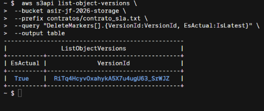

3. Restauración del objeto: elimina el Delete Marker indicando su VersionId específico.
 
 ```
 
 aws s3api delete-object \
 --bucket asir-alumno-2026-storage \
 --key contratos/contrato_sla.txt \
 --version-id "PEGAR_AQUI_EL_VERSION_ID_DEL_DELETE_MARKER"

```
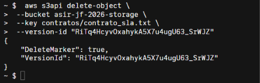

4. Verificación: vuelve a ejecutar ```aws s3 ls```. El fichero debe reaparecer automáticamente como objeto activo.

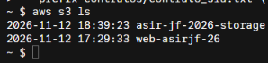

## Fase 4: Configuración de políticas de ciclo de vida (Lifecycle Rules)

Implementa una directiva corporativa que regule dos prefijos diferentes dentro del bucket (recuerda que los prefijos equivalen a las carpetas en S3):

* Prefijo <b>backups/:</b> archivos pesados que deben transicionar rápido a almacenamiento frío.
* Prefijo <b>documentacion/:</b> archivos de consulta habitual que requieren retención histórica pero depuración de versiones obsoletas.

Crear el fichero <b>local lifecycle_policy.json</b> con la siguiente definición técnica:

```

{
  "Rules": [
    {
      "ID": "PoliticaArchivadoBackups",
      "Filter": {
        "Prefix": "backups/"
      },
      "Status": "Enabled",
      "Transitions": [
        {
          "Days": 30,
          "StorageClass": "STANDARD_IA"
        },
        {
          "Days": 90,
          "StorageClass": "GLACIER"
        }
      ],
      "Expiration": {
        "Days": 365
      }
    },
    {
      "ID": "GestionVersionesDocumentacion",
      "Filter": {
        "Prefix": "documentacion/"
      },
      "Status": "Enabled",
      "NoncurrentVersionTransitions": [
        {
          "NoncurrentDays": 30,
          "StorageClass": "GLACIER"
        }
      ],
      "NoncurrentVersionExpiration": {
        "NoncurrentDays": 90
      },
      "AbortIncompleteMultipartUpload": {
        "DaysAfterInitiation": 7
      }
    }
  ]
}

```

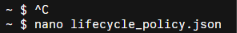

1. Aplica la directiva:

```

 aws s3api put-bucket-lifecycle-configuration \
 --bucket asir-alumno-2026-storage \
 --lifecycle-configuration file://lifecycle_policy.json

```
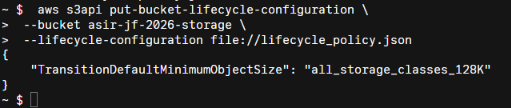

2. Valida la directiva aplicada:
 
```
 aws s3api get-bucket-lifecycle-configuration --bucket asir-alumno-2026-storage

```
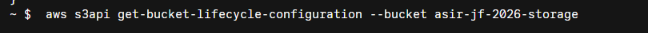

3. <b>Comprobación visual:</b> Accede a la consola web de AWS -> S3 -> Su bucket -> Pestaña <b> Management</b> y verifica cómo se representan gráficamente las transiciones y expiraciones.

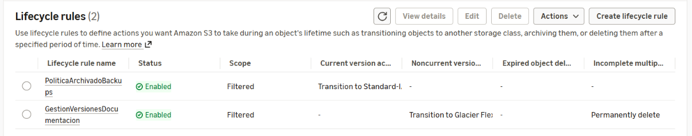

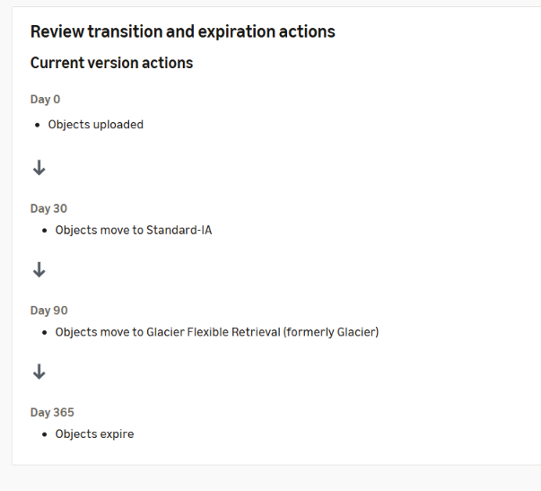

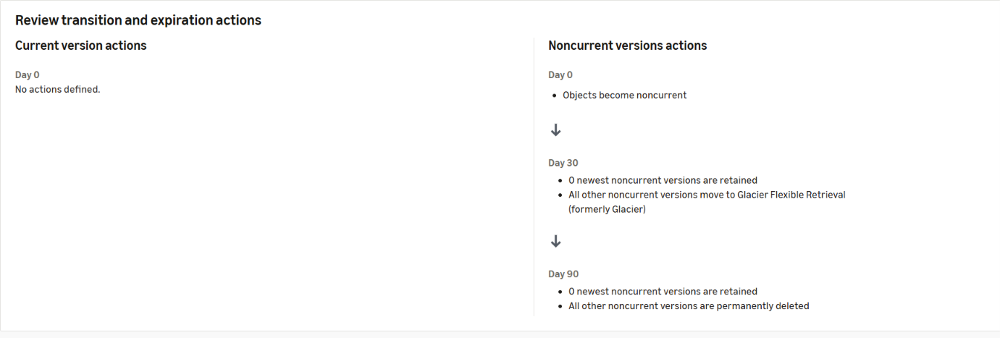

## Fase 5: Estudio económico y comparativa de costes
Para justificar técnicamente la política ante el departamento financiero, debes cumplimentar la siguiente tabla comparativa utilizando los precios vigentes de la región us-east-1 (consulta la página oficial de tarifas de AWS S3) y responde a las cuestiones planteadas:


|Clase de Almacenamiento|Coste aprox. ($/GB/mes)|Tiempo mínimo de facturación|Tamaño mínimo facturable|Tiempo de recuperación (Retrieval)|
|-----------------------|-----------------------|----------------------------|------------------------|----------------------------------|
|     S3 Standard       |        ~$0.023        |           Ninguno          |        Ninguno         |    Inmediato  (milisegundos)     |
|     S3 Standard-IA    |
|-----------------------------------