# PR0301: Despliegue automatizado de servidor web mediante User Data y metadatos IMDSv2

### PASO:1. Creación del Grupo de Seguridad (Security Group) <br>

Antes de lanzar el cómputo, se deben definir las políticas de filtrado de tráfico.

1. En la consola de AWS, acceder a EC2 > Network & Security > Security Groups.

2. Pulsar en Create security group y rellenar los datos:

* Security group name: sg-servidor-web-asir

* Description: Permitir acceso HTTP publico y SSH desde el aula

* VPC: Seleccionar la VPC por defecto del laboratorio.
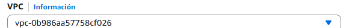

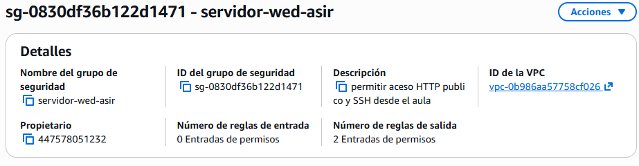
3. Configurar las reglas de entrada (Inbound rules):

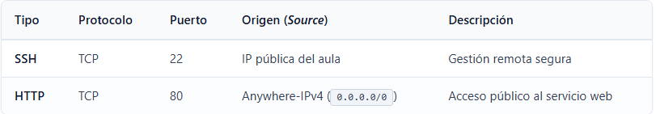
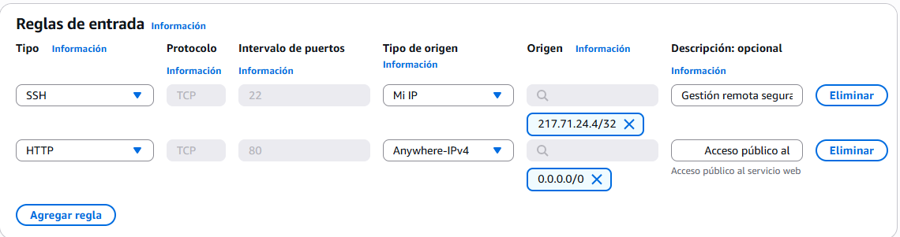

1. Dejar las reglas de salida (Outbound rules) por defecto (todo el tráfico permitido hacia 0.0.0.0/0) para que la máquina pueda descargar paquetes del repositorio oficial de AWS.
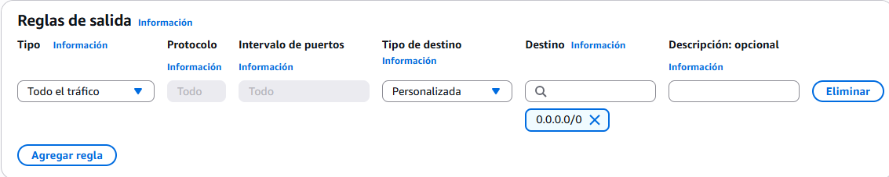

2. Guardar pulsando en Create security group.

### Paso 2: Análisis del script de User Data
El siguiente script se inyectará en la instancia durante el asistente de lanzamiento. <br> 

* Creamos el Script
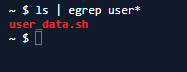


### Paso 3: Lanzamiento de la Instancia EC2

1. Ir a EC2 > Instances > Launch Instances.

2. Name and tags: Asignar el nombre web-server-{iniciales}-01.
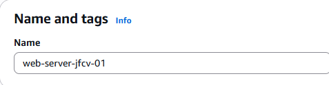

3. Application and OS Images (Amazon Machine Image): Seleccionar Amazon Linux 2023 AMI (arquitectura x86_64).
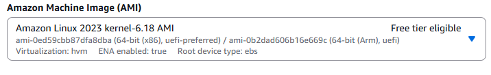

4. Instance type: Seleccionar t2.micro o t3.micro
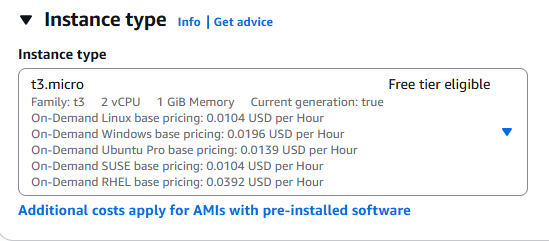

5. Key pair (login): Crear una clave personal .pem para acceder por terminal.
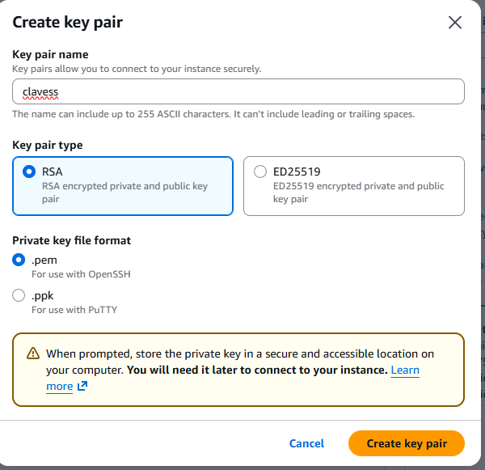

6. Network settings:
    * Pulsar en Edit.
    * VPC: VPC por defecto.

    * Auto-assign public IP: asegurarse de que esté en Enable.

    * Firewall (security groups): seleccionar Select existing security group y marcar sg-servidor-web-asir.
    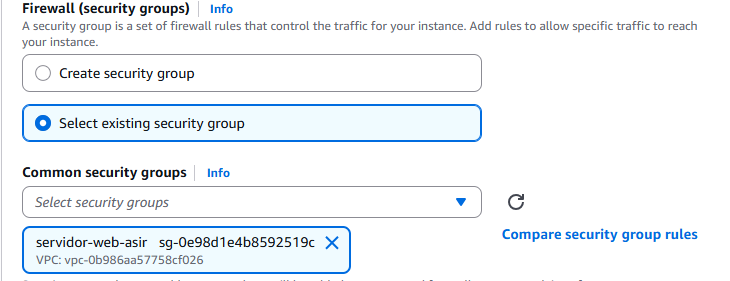

7. Advanced details:
    * Desplegar la sección inferior.
    * Metadata version: comprobar que esté seleccionado V2 only (token required) o V1 and V2 (token optional). Para forzar buenas prácticas, fijarlo en V2 only.
    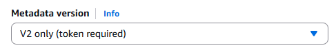
    
    * Localizar el cuadro de texto User data al final de la página y pegar el script completo del Paso 2. <br>
    
    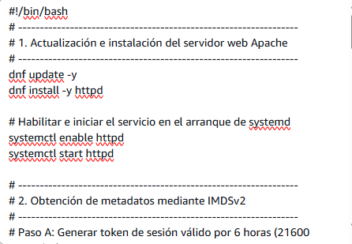
    Puedes Descargar el scrip que habiamos hecho y subirlo
    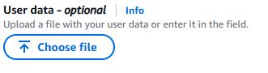
    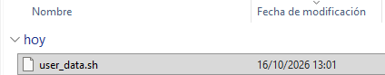

8. Pulsar en Launch instance.


### Paso 4: Verificación y resolución de problemas

1. Comprobación vía navegador web

    1. En la lista de instancias, esperar a que el estado pase a Running y los dos chequeos de estado indiquen 2/2 checks passed.
    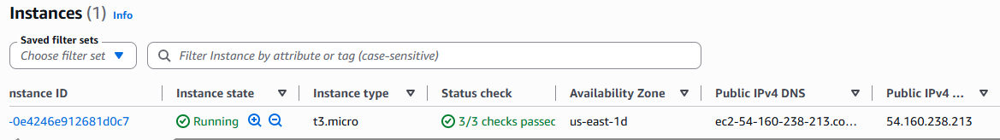
    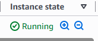
    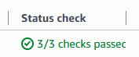

    2. Copiar la Public IPv4 address o la Public IPv4 DNS.
    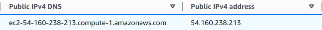

    3. Abrir una pestaña en el navegador y acceder por HTTP (Asegurate de que el navegador no redirija automáticamente a https://, ya que el puerto 443 no está configurado).

    

2. Inspección del log del sistema por SSH
    * Modifcamos las reglas para podernos conectar desde CloudShell por que antes solo nos podiamos conecatrde desde la red del instituto
    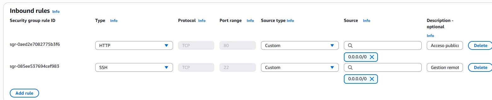

    * Modifcamos los permisos de las claves para que no sea accesible para otros
    

    Para verificar el comportamiento de ```cloud-init``` y cómo se procesó el script:

    1. Conectarse a la máquina mediante SSH:
    ```  ssh -i "clave_privada.pem" ec2-user@<TU_IP_PUBLICA>```
    
    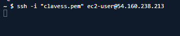
    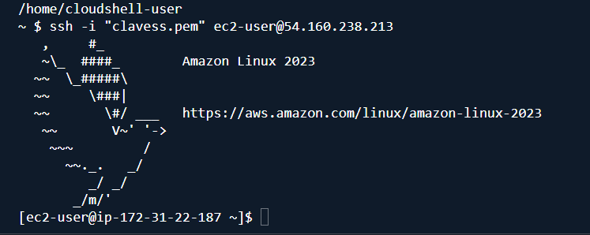

    2. Inspeccionar el registro de salida de arranque:
    ```   sudo cat /var/log/cloud-init-output.log```
    
    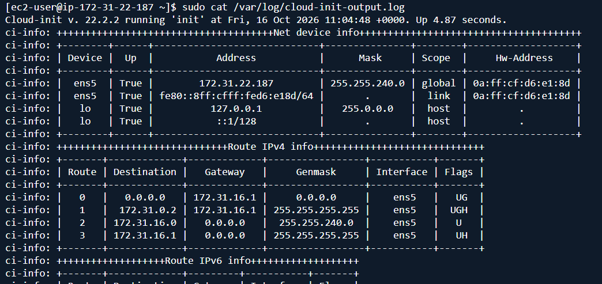

    3. Comprobar manualmente la consulta a IMDSv2 desde la propia terminal:

   ``` TOKEN=$(curl -s -X PUT "http://169.254.169.254/latest/api/token" -H "X-aws-ec2-metadata-token-ttl-seconds: 60") ``` <br>

    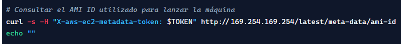
    
    * Este es lo que nos devuelve
    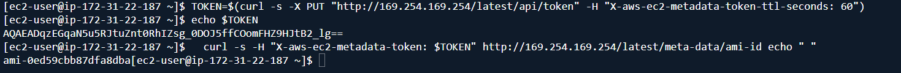
