# PR0302: Gestión de volúmenes EBS secundarios y clonación con AMIs

### ARQUITECTURA
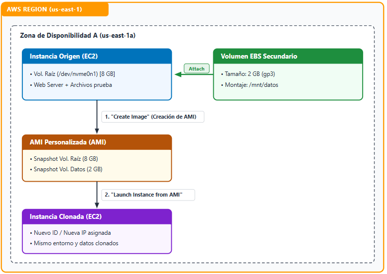

## Paso 1: Verificación de la zona y lanzamiento de la máquina base

1. En la consola de AWS, acceder a EC2 > Instances.

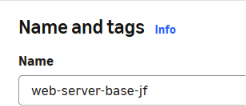


2. Lanzar una instancia base con Amazon Linux 2023, tipo t2.micro o t3.micro, asociada al Security Group de servidor web (sg-servidor-web-asir) y con par de claves.
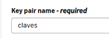

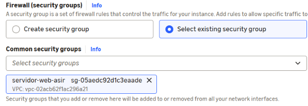

3. No te olvides de seleccionar la instancia en el panel y localizar en los detalles el campo <b>Availability Zone</b> (por ejemplo, us-east-1a). Anota este valor exacto.

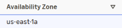

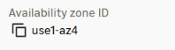

## Paso 2: Creación y conexión del volumen EBS

1. En el menú lateral izquierdo, navegar a <b>Elastic Block Store</b> > <b>Volumes</b>.
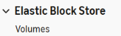

2. Pulsar en <b>Create volume</b> y configurar los parámetros:
    
    * Volume type: General Purpose SSD (gp3).
    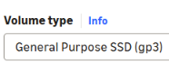

    * Size (GiB): 2 (suficiente para la prueba y ahorra cuota de laboratorio).

    * Availability Zone: seleccionar exactamente la misma zona que la instancia del Paso 1.
    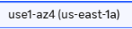

    * Tags: Clave Name, Valor ebs-datos-asir.
    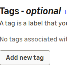
    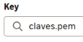
    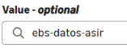

3. Hacer clic en Create volume. Esperar unos segundos a que el estado del volumen cambie de Creating a Available.

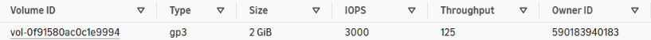
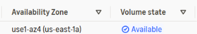

4. Seleccionar el volumen recién creado, pulsar en el menú <b>Actions</b> > <b>Attach volume</b>.

5. En el campo Instance, seleccionar la máquina virtual base.
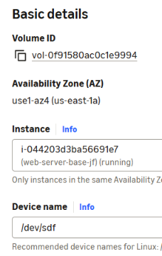

6. En <b>Device name</b>, la consola propondrá una ruta estándar como ```/dev/sdf```. Aceptar el valor por defecto y confirmar pulsando en <b>Attach volume</b>. El estado del volumen pasará a <b>In-use</b>.
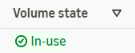

## Paso 3: Configuración del almacenamiento en el sistema operativo

1. Conectarse a la instancia mediante SSH con el usuario ```ec2-user```.
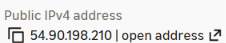
  ```  ssh -i "claves.pem" ec2-user@<TU_IP_PUBLICA>```
  
  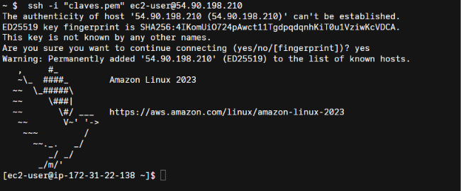

2. Inspeccionar la topología de bloques detectada por el núcleo de Linux con ```lsblk```. Deberías observar aquí el disco raíz (```nvme0n1```) con sus particiones y un nuevo disco sin particionar de 2 GB denominado generalmente ```nvme1n1```.
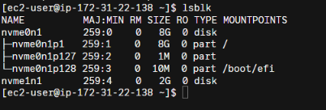

3. Verificar si el nuevo disco contiene ya algún sistema de archivos con ````udo file -s /dev/nvme1n1```. Si la respuesta es ```/dev/nvme1n1: data```, el disco está completamente vacío y requiere formateo.
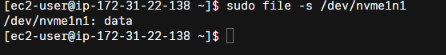

4. Formatear el dispositivo completo directamente con el sistema de archivos ext4 con la orden ```sudo mkfs -t ext4 /dev/nvme1n1```
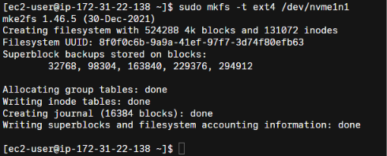

5. Crear el directorio que servirá como punto de montaje (```mkdir -p /mnt/datos```) y asociar el disco ```sudo mount /dev/nvme1n1 /mnt/datos```

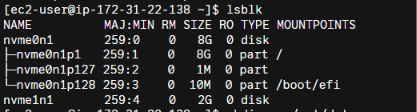
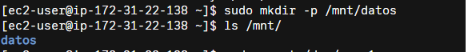
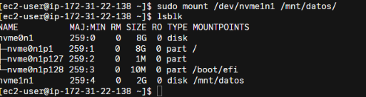

6. Crear un archivo de prueba para comprobar la persistencia de datos:

```

 echo "Datos de producción en volumen EBS - $(date)" | sudo tee /mnt/datos/evidencia.txt
 ls -la /mnt/datos/

```

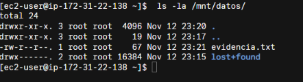

## Paso 4: Automatización del montaje en /etc/fstab mediante UUID

1. Obtener el UUID asignado a la partición o disco formateado: ```sudo blkid /dev/nvme1n1```. Copiar el identificador alfanumérico que aparece en el atributo UUID="..." (por ejemplo, e2a7b8c1-3f4a-4b9a-8e2b-1a2b3c4d5e6f).
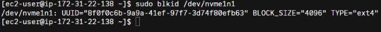

2. Crear una copia de respaldo del archivo de configuración antes de editarlo: ```sudo cp /etc/fstab /etc/fstab.bak```
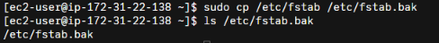

3. Abrir ```/etc/fstab``` con un editor de texto y añadir al final del archivo una línea con la siguiente sintaxis (reemplazando el UUID por el obtenido):
 
```

 UUID=tu-uuid-aqui    /mnt/datos    ext4    defaults,nofail    0    2

```
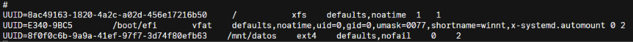

4. Para comprobar que la sintaxis de ```/etc/fstab``` es correcta antes de reiniciar, desmontar el disco y forzar la recarga de todos los puntos de montaje declarados realiza la siguiente comprobación. Si el comando mount -a no devuelve ningún error y al ejecutar ```df -h /mnt/datos``` el disco vuelve a aparecer montado, la configuración es correcta y segura frente a reinicios.
 
 ```
 
 sudo umount /mnt/datos
 sudo mount -a

```

## Paso 5: Creación de la AMI (Amazon Machine Image)

1. En la consola de AWS, ir a <b>EC2</b> > <b>Instances.</b>

2. Seleccionar la instancia configurada, pulsar en <b>Actions</b> > <b>Image and templates</b> > <b>Create image</b>.
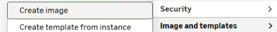
3. Rellenar los campos requeridos:
    
    * Image name: ami-servidor-completo-asir.
    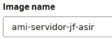
    
    * Image description: Imagen con volumen EBS secundario montado.
    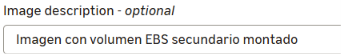

    * En la tabla Instance volume snapshot and disk settings, observar que AWS detecta automáticamente tanto el volumen raíz ```(/dev/xvda)``` como el volumen secundario recién 
    conectado ```(/dev/sdf)```.
    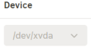

4. Pulsar en Create image.

5. Ir a la sección Images > AMIs en el menú izquierdo. El estado inicial será ```pending```. El proceso tardará unos minutos mientras AWS genera los snapshots en S3; esperar a que el estado cambie a <b>Available</b>.

## Paso 6: Lanzamiento y verificación de la instancia clonada

1. Con la AMI en estado Available, seleccionarla y hacer clic en el botón superior <b>Launch instance from AMI</b>.

2. En el asistente de configuración:

    * Name: servidor-clonado-asir.
    * Instance type: t2.micro o t3.micro.
    * Key pair: seleccionar tu par de claves.
    * Network settings: asignar el mismo Security Group (sg-servidor-web-asir) y asegurar que <b>Auto-assign public IP</b> esté habilitado.
    * En la sección <b>Configure storage</b>, verificar que la plantilla ya incluye los dos discos (el raíz de 8 GB y el secundario de 2 GB) heredados de la AMI.

3. Pulsar en Launch instance.

4. Una vez la nueva máquina esté en estado <b>Running</b>, conectarse a ella mediante SSH usando su nueva IP pública: ```ssh -i "clave_privada.pem" ec2-user@<IP_PUBLICA_DEL_CLON> ```
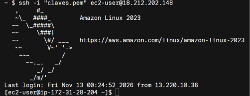
5. Verificar si el volumen secundario y los datos existen en la máquina clonada con los siguientes comandos. El disco secundario se habrá creado como un nuevo volumen EBS a partir del snapshot, y el sistema operativo lo habrá montado automáticamente en ```/mnt/datos``` durante el arranque gracias a la entrada clonada en ```/etc/fstab```, conteniendo el archivo ```evidencia.txt``` íntegro.

```

 lsblk
 df -h /mnt/datos
 cat /mnt/datos/evidencia.txt

 ```
 
 ----

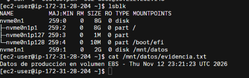

# [INDEX](../INDICE.md)