# PR0303: Arquitectura web redundante con Application Load Balancer y Auto Scaling

### ARQUITECTURA
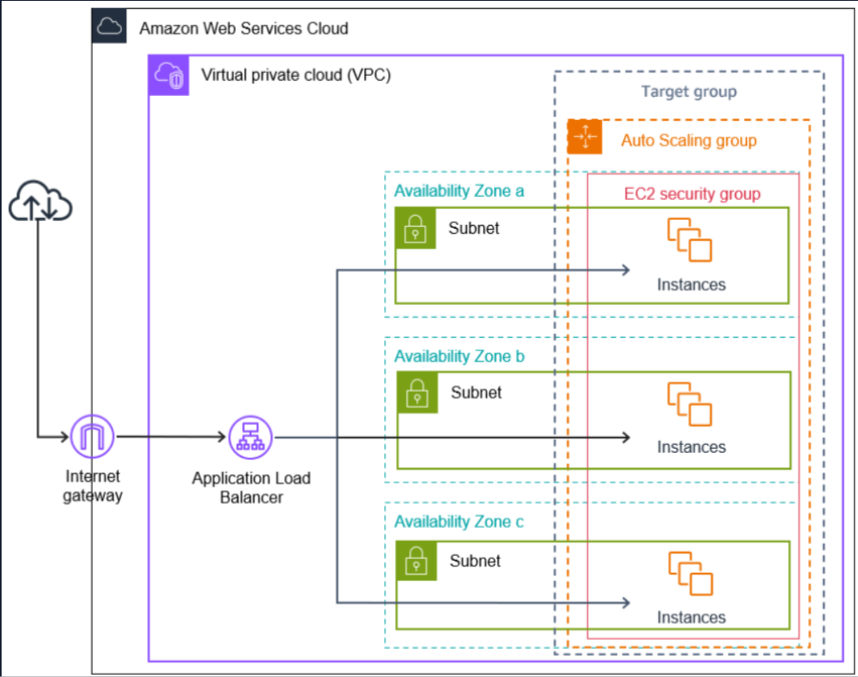

## Paso 1: Configuración de los Security Groups encadenados
1. En la consola de AWS, navegar a EC2 > Network & Security > Security Groups.
2. Crear el Security Group para el balanceador:

    * Name: sg-alb-publico
    * Description: Permitir entrada HTTP publica al balanceador
    * VPC: VPC por defecto del laboratorio.
    * Inbound rule: Tipo HTTP, Puerto 80, Source 0.0.0.0/0.
    * Guardar el grupo. Copiar el identificador generado (ejemplo: sg-0123456789abcdef0).

3. Crear el Security Group para las instancias EC2:

    * Name: sg-ec2-backend
    * Description: Permitir trafico HTTP unicamente desde el ALB y SSH para administracion
    * VPC: VPC por defecto del laboratorio.
    * Inbound rules:
        * Regla 1 (HTTP): Tipo HTTP, Puerto 80, Source: escribir sg- y seleccionar el grupo sg-alb-publico creado en el paso anterior.
        * Regla 2 (SSH): Tipo SSH, Puerto 22, Source My IP (para pruebas de diagnóstico).

        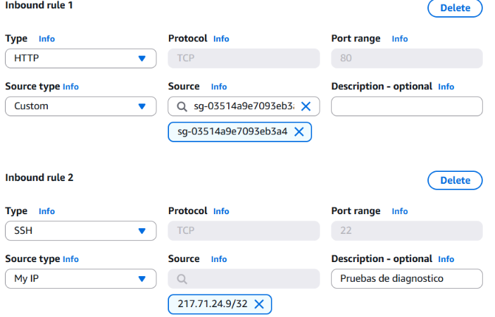
## Paso 2: Creación de la plantilla de lanzamiento
1. En el menú lateral izquierdo de EC2, ir a Instances > Launch Templates y pulsar en Create launch template.
2. Launch template name: lt-servidor-web-asir.
3. Application and OS Images: seleccionar Amazon Linux 2023 AMI.
4. Instance type: t2.micro o t3.micro.
5. Key pair: seleccionar un par de claves
6. Network settings:
    
    * No asignar subred aquí (el ASG se encargará de distribuirlas).
    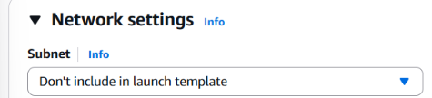
    * Firewall (security groups): seleccionar sg-ec2-backend.
    
    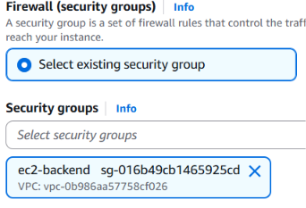

7. Advanced details:
    
    * Metadata version: V2 only (token required).
    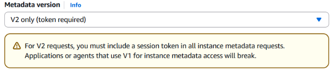
    * User data: pegar el siguiente script automatizado:
    
```
   
    #!/bin/bash
 dnf update -y
 dnf install -y httpd stress

 systemctl enable httpd
 systemctl start httpd

 TOKEN=$(curl -s -X PUT "http://169.254.169.254/latest/api/token" -H "X-aws-ec2-metadata-token-ttl-seconds: 21600")
 INSTANCE_ID=$(curl -s -H "X-aws-ec2-metadata-token: $TOKEN" http://169.254.169.254/latest/meta-data/instance-id)
 AZ=$(curl -s -H "X-aws-ec2-metadata-token: $TOKEN" http://169.254.169.254/latest/meta-data/placement/availability-zone)
 PRIVATE_IP=$(curl -s -H "X-aws-ec2-metadata-token: $TOKEN" http://169.254.169.254/latest/meta-data/local-ipv4)

 cat <<EOF > /var/www/html/index.html
 <!DOCTYPE html>
 <html lang="es">
 <head>
     <meta charset="UTF-8">
     <title>Cluster Web ASIR</title>
     <style>
         body { font-family: monospace; background-color: #0f172a; color: #f8fafc; text-align: center; padding-top: 50px; }
         .box { display: inline-block; background: #1e293b; padding: 30px; border-radius: 12px; border: 2px solid #38bdf8; }
         h1 { color: #38bdf8; }
         .data { font-size: 1.2rem; margin: 10px 0; }
         .highlight { color: #facc15; font-weight: bold; }
     </style>
 </head>
 <body>
     <div class="box">
         <h1>Servidor Backend Operativo</h1>
         <p class="data">Instancia: <span class="highlight">$INSTANCE_ID</span></p>
         <p class="data">Zona de Disponibilidad: <span class="highlight">$AZ</span></p>
         <p class="data">IP Privada: <span class="highlight">$PRIVATE_IP</span></p>
     </div>
 </body>
 </html>
 EOF

```

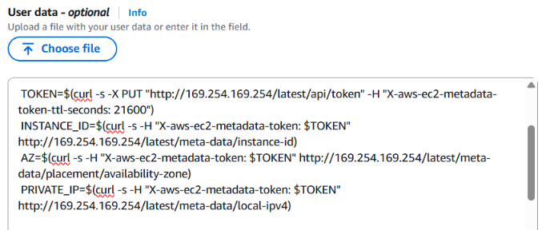
8. Pulsar en Create launch template.

## Paso 3: Creación del Target Group
1. Ir a Load Balancing > Target Groups y hacer clic en Create target group.
2. Basic configuration:
    
    * Target type: Instances.
    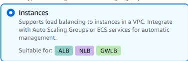

    * Target group name: tg-web-asir.
    
    
    * Protocol: HTTP, Port: 80.
    * VPC: VPC por defecto.

3. Health checks:
    * Health check protocol: HTTP.
    * Health check path: /.
    * En Advanced health check settings, ajustar para acelerar las pruebas:
    * Healthy threshold: 2.
    * Unhealthy threshold: 2.
    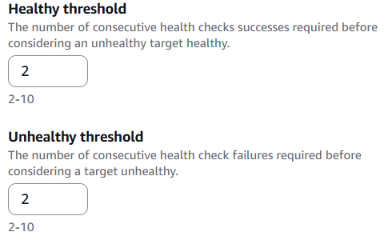
    
    * Interval: 10 segundos.
    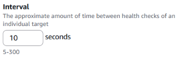
4. Pulsar en Next. En la pantalla de registro de destinos (Register targets), no registrar ninguna instancia manualmente, ya que el Auto Scaling Group se encargará de esta tarea.
5. Hacer clic en Create target group.

## Paso 4: Creación del Application Load Balancer (ALB)
1. Ir a Load Balancing > Load Balancers y hacer clic en Create load balancer.
2. Seleccionar Application Load Balancer (pulsar en Create).
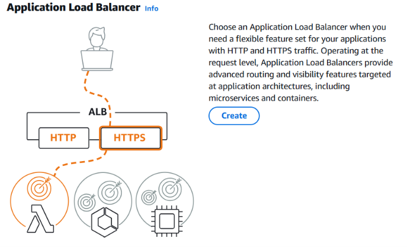
3. Basic configuration:
   
    * Load balancer name: alb-web-asir.
    * Scheme: Internet-facing (público).
    * IP address type: IPv4.

4. Network mapping:
    * VPC: VPC por defecto.
    * Mappings: Marcar al menos dos subredes correspondientes a dos Zonas de Disponibilidad distintas (por ejemplo, us-east-1a y us-east-1b).
    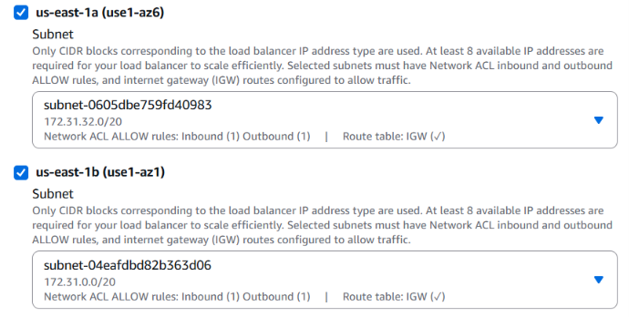

5. Security groups:
    * Eliminar el grupo por defecto.
    * Seleccionar exclusivamente sg-alb-publico.

6. Listeners and routing:
    * Protocol HTTP, Port 80.
    * Default action: Reenviar a (Forward to) tg-web-asir.
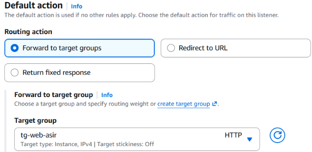

7. Pulsar en Create load balancer.

8. El balanceador tardará entre 2 y 3 minutos en aprovisionarse. Localizar en su panel de detalles el campo DNS name (ejemplo: alb-web-asir-123456789.us-east-1.elb.amazonaws.com).
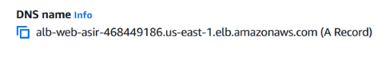

## Paso 5: Creación del Auto Scaling Group (ASG)
1. Ir a Auto Scaling > Auto Scaling Groups y pulsar en Create Auto Scaling group.
### 2. Paso 1 (Choose launch template or configuration):

* Auto Scaling group name: asg-web-asir.
* Launch template: Seleccionar lt-servidor-web-asir (versión Default o Latest). Pulsar en Next.

### 3. Paso 2 (Choose instance type and network):

* VPC: VPC por defecto.
* Availability Zones and subnets: Seleccionar las mismas dos subredes elegidas para el balanceador en el Paso 4. Pulsar en Next.
### 4. Paso 3 (Configure advanced options):

* Load balancing: Marcar Attach to an existing load balancer.
* Seleccionar Choose from your load balancer target groups y elegir tg-web-asir.
* Health checks: Marcar la casilla Turn on Elastic Load Balancing health checks.
* Health check grace period: 120 segundos (tiempo para que el script User Data instale Apache antes de que el ASG considere la máquina fallida). Pulsar en Next.
### 5. Paso 4 (Configure group size and scaling policies):

* Desired capacity: 2.
* Minimum capacity: 2.
* Maximum capacity: 4.
* Scaling policies: Seleccionar Target tracking scaling policy.
* Policy name: politica-cpu-50.
* Metric type: Average CPU utilization.
* Target value: 50 (escalará si la media de CPU del grupo supera el 50%).
* Warmup period: 60 segundos. Pulsar en Next.

6. Omitir notificaciones y etiquetas pulsando en Next hasta la pantalla final.
7. Pulsar en <b>Create Auto Scaling group.</b>

## Paso 6: Verificación del balanceo de carga
1. Ir a EC2 > Instances. Observar cómo el ASG lanza automáticamente 2 instancias nuevas.
2. Ir a Load Balancing > Target Groups > tg-web-asir > pestaña Targets.
3. Esperar hasta que ambas instancias muestren el estado Healthy en el chequeo de salud.
4. Abrir una terminal en el equipo local y ejecutar un bucle para comprobar cómo el ALB reparte las peticiones entre los servidores de forma alterna (Round-Robin):
 
```

# Reemplazar con el DNS name real de tu ALB
 ALB_DNS="alb-web-asir-123456789.us-east-1.elb.amazonaws.com"

 for i in {1..10}; do
 curl -s http://$ALB_DNS | grep -E "Instancia:|Zona de Disponibilidad:"
 sleep 1
 done


```
Resultado esperado: La salida alternará entre los dos instance-id y mostrará las dos Zonas de Disponibilidad configuradas, demostrando que el tráfico no recae en un único servidor.

## Paso 7: Prueba de estrés y validación del autoescalado
1. Desde la consola de EC2, copiar la IP pública de una de las dos instancias en ejecución.
2. Conectarse a ella por SSH

```

 ssh -i "tu_clave.pem" ec2-user@<IP_PUBLICA_DE_UNA_INSTANCIA>

```

3. Ejecutar la herramienta stress (instalada en el User Data) para forzar el uso de la CPU al 100% durante 8 minutos:

```

stress --cpu 2 --timeout 480s

```

4. Mientras el comando se ejecuta, abrir la consola de AWS en otra pestaña:
    
    * Ir a CloudWatch > Alarms. Observar cómo la alarma generada por el ASG pasa del estado OK a In alarm.
    * Ir a Auto Scaling Groups > asg-web-asir > pestaña Activity.
    * Observar cómo el grupo detecta la sobrecarga y ejecuta la acción: Launching a new EC2 instance.
    * El número de instancias en Instances pasará de 2 a 3 (o 4).
    
5. Tras expirar los 480 segundos del comando stress, la CPU bajará a valores mínimos.
6. Esperar unos minutos y verificar en la pestaña Activity del ASG cómo se activa el proceso de reducción (Scale-In), terminando las instancias adicionales hasta regresar a la capacidad deseada de 2.
