# PR0304:Despliegue de servicios en contenedores con Amazon ECS sobre AWS Fargate
## Objetivos de la práctica
1. Comprender el modelo de ejecución de contenedores sin servidor mediante AWS Fargate.
2. Diseñar y configurar una Definición de Tarea (Task Definition) especificando límites de recursos y mapeo de puertos.
3. Desplegar un clúster y un Servicio ECS en modo réplica asignando direcciones IP públicas efímeras en una VPC.
4. Inspeccionar la traza de eventos y la recopilación centralizada de registros mediante <b>Amazon CloudWatch Logs</b>.
5. Validar la resiliencia y el comportamiento de autorrecuperación (self-healing) del orquestador ante la caída forzosa de tareas.

### Paso 1: Creación del clúster ECS con AWS Fargate
1. En la consola de AWS, buscar y acceder a ECS (Elastic Container Service).
2. En el panel izquierdo, hacer clic en Clusters y pulsar en Create cluster.
3. Rellenar los parámetros de configuración:

    * Cluster name: cluster-asir-fargate
    * Infrastructure: Marcar la casilla AWS Fargate (serverless).

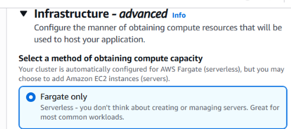

4. Dejar el resto de opciones por defecto (VPC y subredes por defecto del laboratorio).
5. Pulsar en Create. El proceso tardará unos segundos.

### Paso 2: Creación de la Definición de Tarea (Task Definition)
1. En el menú lateral izquierdo de ECS, ir a Task definitions y pulsar en Create new task definition.
2. Configuration:

    * Task definition family: task-web-asir.
    * Launch type: Seleccionar AWS Fargate.
    * Operating system/architecture: Linux/X86_64.
    * Network mode: awsvpc (obligatorio para Fargate).

3. Task size (Recursos de cómputo):
    * Task CPU: 0.25 vCPU (256 unidades).
    * Task memory: 0.5 GB (512 MB).

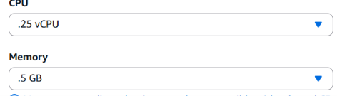

4. Container - 1:
   
    * Name: web-nginx.
    * Image uri: Utilizar una imagen pública estándar de Docker Hub, por ejemplo: nginx:alpine o una imagen web personalizada alojada en Amazon ECR.
    * Port mappings:
    * Container port: 80.
    * Protocol: tcp.
    * App protocol: HTTP.

5. Environment / Roles (Restricción de AWS Academy):

    * Localizar la sección Task execution role y asegurarse de seleccionar el rol existente denominado LabRole (esto permite a ECS descargar imágenes y escribir logs en CloudWatch sin crear nuevos roles IAM).

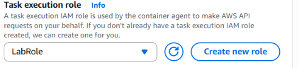

6. Pulsar en Create en la esquina inferior derecha.

### Paso 3: Despliegue del Servicio ECS
1. Una vez creada la definición de tarea, pulsar en el botón superior Deploy > Create service.
2. Environment:
    
    * Compute configuration: Mantener Launch type.
    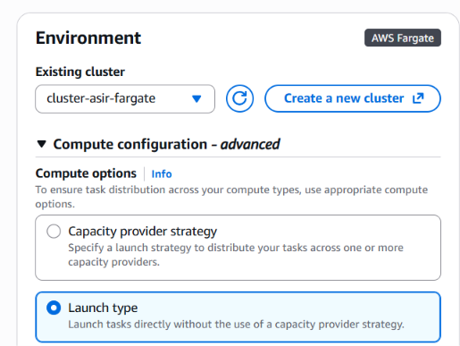
    * Launch type: Fargate.
    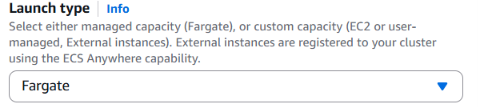
    * Operating system: Linux.

3. Deployment configuration:
    
    * Service name: servicio-web-fargate.
    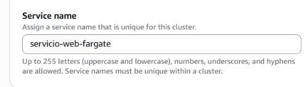
    * Desired tasks: 2 (para garantizar redundancia con dos contenedores simultáneos).
    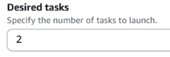

4. Networking:

    * VPC: Seleccionar la VPC por defecto del laboratorio.
    * Subnets: Seleccionar al menos dos subredes públicas.
    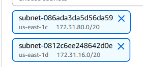
    * Security group: Seleccionar el Security Group de servidor web creado en prácticas anteriores (sg-servidor-web-asir) o crear uno nuevo que permita el tráfico entrante por el puerto 80 (HTTP) desde 0.0.0.0/0.
    * Auto-assign public IP: Asegurarse de marcar Turn on (es indispensable para que los contenedores obtengan una IP pública y puedan ser consultados externamente).

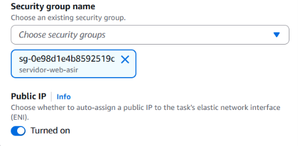

5. Load balancing (Opcional para esta práctica):

    * Seleccionar None (se accederá directamente a las IPs públicas de las tareas en esta fase introductoria).

6. Pulsar en Create service.

### Paso 4: Verificación y pruebas de acceso

1. Entrar al clúster cluster-asir-fargate y hacer clic en la pestaña Services. Seleccionar el servicio servicio-web-fargate.
2. Ir a la pestaña Tasks. Se observarán dos tareas en estado PROVISIONING o PENDING. Esperar 1-2 minutos hasta que el estado cambie a RUNNING.
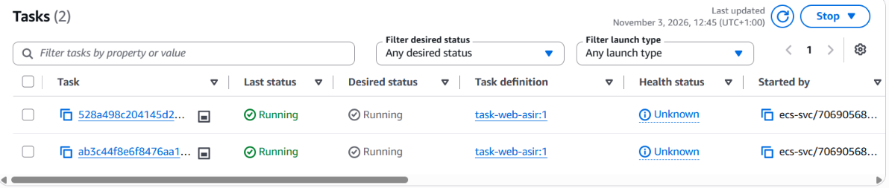
3. Hacer clic sobre el identificador (Task ID) de una de las tareas en ejecución.
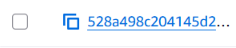

4. En los detalles de red, localizar la dirección Public IP.
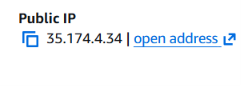
5. Copiar la IP pública, abrir una pestaña en el navegador web e introducir: 
* visualizamos en otra red o en el movil
```
 text http://

```

Resultado esperado: Se visualizará la página de bienvenida por defecto de Nginx (“Welcome to nginx!”), demostrando que el contenedor está respondiendo peticiones HTTP sobre Fargate sin haber configurado ninguna máquina virtual EC2 de forma manual.

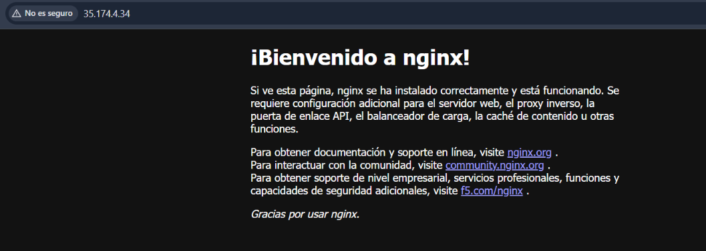

### Paso 5: Monitorización y resiliencia (Self-Healing)

1. <b>Inspección de logs en Amazon CloudWatch</b>
    
    1. En la pestaña Logs dentro de los detalles de la tarea ECS, se puede observar la consola de salida estándar del contenedor.
    2. Comprobar cómo cada petición HTTP realizada en el paso anterior genera un registro (access log) en tiempo real centralizado en Amazon CloudWatch Logs, sin necesidad de acceder por SSH a ningún servidor.

2. <b>Prueba de</b> resiliencia del orquestador
En la pestaña Tasks del servicio ECS, seleccionar una de las tareas en ejecución y pulsar en el botón superior Stop (o Stop task).
Observar el comportamiento del servicio: al tratarse de un servicio configurado con una capacidad deseada de 2 réplicas (Desired tasks: 2), el orquestador ECS detecta inmediatamente que el número de tareas activas ha caído a 1.
De forma automática, ECS inicia el aprovisionamiento de una nueva tarea Fargate para restaurar el estado deseado de la infraestructura. Esta capacidad de autorrecuperación constituye una de las mayores ventajas frente al modelo tradicional de servidores estáticos.

# [INDICE](../INDICE.md)